# Scenario review

Generated by `node scripts/scenarios-report.mjs 3300 --screens` against a running `next start`. Every bill is synthetic and marked SAMPLE.
Prices come from the baked snapshot (`demo=1`), so the numbers do not move with live data.

**16 of 16 scenarios show what the matrix expects.**

Regenerate the bills with `node scripts/demo-bills/scenarios.mjs`. The matrix is `lib/scenarios/scenarios.ts`; the pipeline tests are `lib/scenarios/__tests__/scenarios.test.ts`.

| Scenario | Bills | Expected | Shown | Headline | What to do next | Contacts | Match |
| --- | --- | --- | --- | --- | --- | --- | --- |
| [Oil, income-qualified, enhanced rebate](#oil-enhanced-income) | [electric](../../public/demo-bills/scenarios/oil-enhanced-income/electric.png) · [heating](../../public/demo-bills/scenarios/oil-enhanced-income/heating.png) | Switch now | Switch now | You’d save $3,659 a year on heating. | Our recommendation: get heat pump quotes now | yes | ok |
| [Oil, standard income, install in 2027](#oil-standard-income-2027) | [electric](../../public/demo-bills/scenarios/oil-standard-income-2027/electric.png) · [heating](../../public/demo-bills/scenarios/oil-standard-income-2027/heating.png) | Switch now | Switch now | You’d save $3,063 a year on heating. | Our recommendation: get heat pump quotes now | yes | ok |
| [Oil, standard income, install in 2026](#oil-standard-before-dec31) | [electric](../../public/demo-bills/scenarios/oil-standard-before-dec31/electric.png) · [heating](../../public/demo-bills/scenarios/oil-standard-before-dec31/heating.png) | Before 31 Dec | Before 31 Dec | You’d save $3,063 a year on heating. | Our recommendation: get heat pump quotes now, before 31 December. The rebate drops by $1,000 on 1 January. | yes | ok |
| [Propane, National Grid, standard income](#propane-national-grid) | [electric](../../public/demo-bills/scenarios/propane-national-grid/electric.png) · [heating](../../public/demo-bills/scenarios/propane-national-grid/heating.png) | Before 31 Dec | Before 31 Dec | You’d save $1,671 a year on heating. | Our recommendation: get heat pump quotes now, before 31 December. The rebate drops by $750 on 1 January. | yes | ok |
| [Natural gas, standard rate](#gas-do-not-switch) | [electric](../../public/demo-bills/scenarios/gas-do-not-switch/electric.png) · [heating](../../public/demo-bills/scenarios/gas-do-not-switch/heating.png) | Don’t switch yet | Don’t switch yet | You’d pay $452 a year more. | Our recommendation: stay with what you have. Check again in January 2027, when prices and rebates reset. | yes | ok |
| [Natural gas on a discount rate (R-4)](#gas-discount-rate) | [electric](../../public/demo-bills/scenarios/gas-discount-rate/electric.png) · [heating](../../public/demo-bills/scenarios/gas-discount-rate/heating.png) | Don’t switch yet | Don’t switch yet | You’d pay $452 a year more. | Our recommendation: stay with what you have. Check again in January 2027, when prices and rebates reset. | yes | ok |
| [Electric resistance heat](#electric-resistance) | [electric](../../public/demo-bills/scenarios/electric-resistance/electric.png) · electric is the heat bill | Before 31 Dec | Before 31 Dec | You’d save $2,746 a year on heating. | Our recommendation: get heat pump quotes now, before 31 December. The rebate drops by $450 on 1 January. | yes | ok |
| [Municipal light plant town (Wellesley)](#municipal-light-plant) | [electric](../../public/demo-bills/scenarios/municipal-light-plant/electric.png) · [heating](../../public/demo-bills/scenarios/municipal-light-plant/heating.png) | Refusal (no verdict shown) | Refusal (no verdict shown) | Mass Save rebates do not apply at this address. | Our recommendation: stay with what you have. Check again in January 2027, when prices and rebates reset. | yes | ok |
| [Mixed-utility town, bill names Eversource](#mixed-town-bill-says-eversource) | [electric](../../public/demo-bills/scenarios/mixed-town-bill-says-eversource/electric.png) · [heating](../../public/demo-bills/scenarios/mixed-town-bill-says-eversource/heating.png) | Before 31 Dec | Before 31 Dec | You’d save $2,306 a year on heating. | Our recommendation: get heat pump quotes now, before 31 December. The rebate drops by $1,000 on 1 January. | yes | ok |
| [Mixed-utility town, bill names the light plant](#mixed-town-bill-says-municipal) | [electric](../../public/demo-bills/scenarios/mixed-town-bill-says-municipal/electric.png) · [heating](../../public/demo-bills/scenarios/mixed-town-bill-says-municipal/heating.png) | Refusal (no verdict shown) | Refusal (no verdict shown) | Mass Save rebates do not apply at this address. | Our recommendation: stay with what you have. Check again in January 2027, when prices and rebates reset. | yes | ok |
| [Competitive supplier above Basic Service](#competitive-supplier) | [electric](../../public/demo-bills/scenarios/competitive-supplier/electric.png) · [heating](../../public/demo-bills/scenarios/competitive-supplier/heating.png) | Before 31 Dec | Before 31 Dec | You’d save $2,587 a year on heating. | Our recommendation: get heat pump quotes now, before 31 December. The rebate drops by $1,000 on 1 January. | yes | ok |
| [High install quote, above the $25,000 loan cap](#high-quote-over-loan-cap) | [electric](../../public/demo-bills/scenarios/high-quote-over-loan-cap/electric.png) · [heating](../../public/demo-bills/scenarios/high-quote-over-loan-cap/heating.png) | Before 31 Dec | Before 31 Dec | You’d save $3,063 a year on heating. | Our recommendation: get heat pump quotes now, before 31 December. The rebate drops by $1,000 on 1 January. | yes | ok |
| [Very high install quote, payback past 15 years](#very-high-quote-payback-fails) | [electric](../../public/demo-bills/scenarios/very-high-quote-payback-fails/electric.png) · [heating](../../public/demo-bills/scenarios/very-high-quote-payback-fails/heating.png) | Don’t switch yet | Don’t switch yet | You’d save $3,063 a year, but it takes 16.8 years to pay back. | Our recommendation: stay with what you have. Check again in January 2027, when prices and rebates reset. | yes | ok |
| [Very low install quote, rebate covers it](#low-quote-rebate-covers) | [electric](../../public/demo-bills/scenarios/low-quote-rebate-covers/electric.png) · [heating](../../public/demo-bills/scenarios/low-quote-rebate-covers/heating.png) | Switch now | Switch now | You’d save $3,659 a year on heating. | Our recommendation: get heat pump quotes now | yes | ok |
| [Unitil town (Fitchburg), oil](#unitil-oil) | [electric](../../public/demo-bills/scenarios/unitil-oil/electric.png) · [heating](../../public/demo-bills/scenarios/unitil-oil/heating.png) | Before 31 Dec | Before 31 Dec | You’d save $3,128 a year on heating. | Our recommendation: get heat pump quotes now, before 31 December. The rebate drops by $900 on 1 January. | yes | ok |
| [Cape Light Compact town (Truro), oil](#cape-light-oil) | [electric](../../public/demo-bills/scenarios/cape-light-oil/electric.png) · [heating](../../public/demo-bills/scenarios/cape-light-oil/heating.png) | Before 31 Dec | Before 31 Dec | You’d save $2,306 a year on heating. | Our recommendation: get heat pump quotes now, before 31 December. The rebate drops by $1,000 on 1 January. | yes | ok |

## Oil, income-qualified, enhanced rebate {#oil-enhanced-income}

Oil home on a discount rate (R-2 plus an Assistance Rate Discount line): income reads as yes and the enhanced tier applies.

- Town: Framingham. Fuel: oil. Install year: 2026. Quote: none (Mass Save average).
- Electric bill: [PNG](../../public/demo-bills/scenarios/oil-enhanced-income/electric.png) · [PDF](../../public/demo-bills/scenarios/oil-enhanced-income/electric.pdf) · [reader JSON](../../public/demo-bills/scenarios/oil-enhanced-income/expected/electric.json)
- Heating bill: [PNG](../../public/demo-bills/scenarios/oil-enhanced-income/heating.png) · [PDF](../../public/demo-bills/scenarios/oil-enhanced-income/heating.pdf) · [reader JSON](../../public/demo-bills/scenarios/oil-enhanced-income/expected/heating.json)
- Verdict link: `/verdict?fuel=oil&units=900&price=6.23&town=Framingham&tier=enhanced&year=2026&inc=yes&m=degree_days&mc=0.7&mn=Scaled+from+the+886+degree+days+printed+on+the+ticket+to+a+5%2C694+degree-day+heating+season.&ut=eversource&er=0.25&li=1&demo=1`
- Expected: Switch now, save_switch, recommendation `quotes`, choices STAY / SHOP_FUEL / SHOP_SUPPLY / SWITCH_HEAT_PUMP.
- Shown: **Switch now**, action "Switch.", tone `switch`. Match: ok.
- Headline: You’d save $3,659 a year on heating.
- What to do next: Our recommendation: get heat pump quotes now
- Contacts: Now: Oil heating; electricity delivered by Eversource. Book a no-cost Home Energy Assessment. 866-527-7283 · Book online This is how a heat pump plan starts. An assessor checks the house and lists the rebates you qualify for. Source: masssave.com/residential: "schedule... or call 866-527-SAVE (7283)", read 2026-10-24 Get installer quotes. Find a Mass Save installer Only installers in the Mass Save network qualify you for the rebate. Ask for two or three written quotes. Source: masssave.com air-source heat pump page, Heat Pump Installer Finder link, read 2026-10-24 Questions about heat pump rebates. 888-855-0340 · Heat pump rebates Source: masssave.com air-source heat pump page, Eligibility: "please call 1-888-855-0340", read 2026-10-24 Finance it. HEAT Loan details A HEAT Loan covers the part the rebate does not. Source: masssave.com Mass Save HEAT Loan Program page (no general loan phone listed), read 2026-10-24 Income verification for enhanced offers. 888-714-3990 · Income-based offers If your household may be income-eligible, higher rebates apply. Source: masssave.com Save with Enhanced Incentives: "call 888-714-3990", read 2026-10-24 Other options: Stay as you are · Shop heating fuel · Shop electricity supply See Framingham on the map →
- The money: Rebate, 2026 install $16,000 2027: $16,000 Net cost after rebate $6,000 on $22,000 installed Payback 1.6 years net cost ÷ yearly saving, undiscounted What the install costs The rebate is subtracted from this number, so a quote changes the net cost, the payback and the loan. It never changes the answer’s honesty. Installed cost, before rebate Mass Save · program average · Baked $ Use this The Mass 

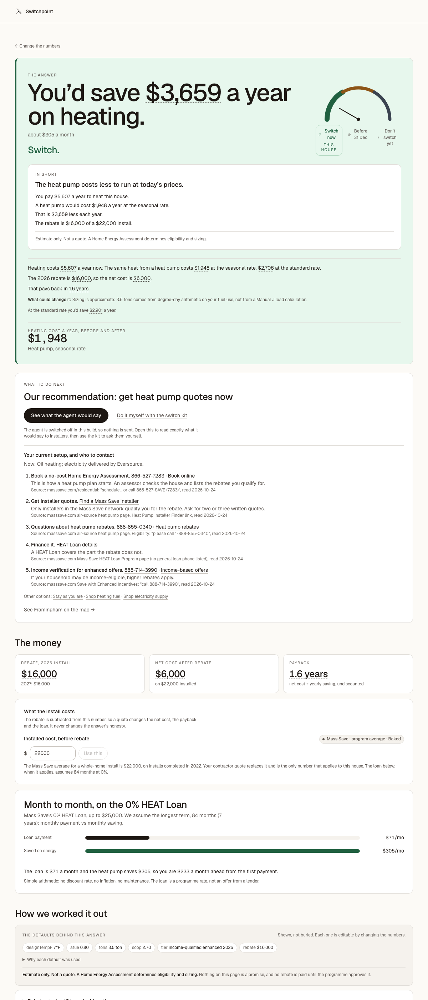

## Oil, standard income, install in 2027 {#oil-standard-income-2027}

Oil home over the income limit, installing after the 1 January step-down so there is no deadline left: SWITCH_NOW.

- Town: Framingham. Fuel: oil. Install year: 2027. Quote: none (Mass Save average).
- Electric bill: [PNG](../../public/demo-bills/scenarios/oil-standard-income-2027/electric.png) · [PDF](../../public/demo-bills/scenarios/oil-standard-income-2027/electric.pdf) · [reader JSON](../../public/demo-bills/scenarios/oil-standard-income-2027/expected/electric.json)
- Heating bill: [PNG](../../public/demo-bills/scenarios/oil-standard-income-2027/heating.png) · [PDF](../../public/demo-bills/scenarios/oil-standard-income-2027/heating.pdf) · [reader JSON](../../public/demo-bills/scenarios/oil-standard-income-2027/expected/heating.json)
- Verdict link: `/verdict?fuel=oil&units=900&price=6.23&town=Framingham&tier=whole&year=2027&inc=no&m=degree_days&mc=0.7&mn=Scaled+from+the+886+degree+days+printed+on+the+ticket+to+a+5%2C694+degree-day+heating+season.&ut=eversource&er=0.305&li=0&demo=1`
- Expected: Switch now, save_switch, recommendation `quotes`, choices STAY / SHOP_FUEL / SHOP_SUPPLY / SWITCH_HEAT_PUMP.
- Shown: **Switch now**, action "Switch.", tone `switch`. Match: ok.
- Headline: You’d save $3,063 a year on heating.
- What to do next: Our recommendation: get heat pump quotes now
- Contacts: Now: Oil heating; electricity delivered by Eversource. Book a no-cost Home Energy Assessment. 866-527-7283 · Book online This is how a heat pump plan starts. An assessor checks the house and lists the rebates you qualify for. Source: masssave.com/residential: "schedule... or call 866-527-SAVE (7283)", read 2026-10-24 Get installer quotes. Find a Mass Save installer Only installers in the Mass Save network qualify you for the rebate. Ask for two or three written quotes. Source: masssave.com air-source heat pump page, Heat Pump Installer Finder link, read 2026-10-24 Questions about heat pump rebates. 888-855-0340 · Heat pump rebates Source: masssave.com air-source heat pump page, Eligibility: "please call 1-888-855-0340", read 2026-10-24 Finance it. HEAT Loan details A HEAT Loan covers the part the rebate does not. Source: masssave.com Mass Save HEAT Loan Program page (no general loan phone listed), read 2026-10-24 Income verification for enhanced offers. 888-714-3990 · Income-based offers If your household may be income-eligible, higher rebates apply. Source: masssave.com Save with Enhanced Incentives: "call 888-714-3990", read 2026-10-24 Other options: Stay as you are · Shop heating fuel · Shop electricity supply See Framingham on the map →
- The money: Rebate, 2027 install $7,500 2027: $7,500 Net cost after rebate $14,500 on $22,000 installed Payback 4.7 years net cost ÷ yearly saving, undiscounted What the install costs The rebate is subtracted from this number, so a quote changes the net cost, the payback and the loan. It never changes the answer’s honesty. Installed cost, before rebate Mass Save · program average · Baked $ Use this The Mass S

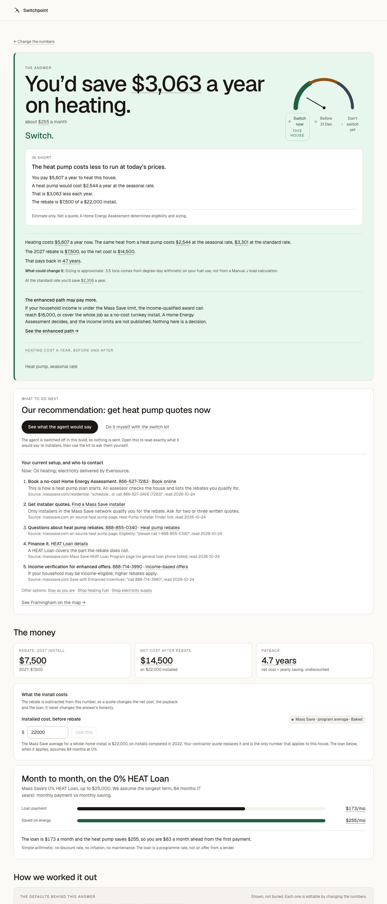

## Oil, standard income, install in 2026 {#oil-standard-before-dec31}

Oil home on the standard whole-home rebate: the rebate drops on 1 January, so the verdict is SWITCH_BEFORE_DEC31.

- Town: Framingham. Fuel: oil. Install year: 2026. Quote: none (Mass Save average).
- Electric bill: [PNG](../../public/demo-bills/scenarios/oil-standard-before-dec31/electric.png) · [PDF](../../public/demo-bills/scenarios/oil-standard-before-dec31/electric.pdf) · [reader JSON](../../public/demo-bills/scenarios/oil-standard-before-dec31/expected/electric.json)
- Heating bill: [PNG](../../public/demo-bills/scenarios/oil-standard-before-dec31/heating.png) · [PDF](../../public/demo-bills/scenarios/oil-standard-before-dec31/heating.pdf) · [reader JSON](../../public/demo-bills/scenarios/oil-standard-before-dec31/expected/heating.json)
- Verdict link: `/verdict?fuel=oil&units=900&price=6.23&town=Framingham&tier=whole&year=2026&inc=no&m=degree_days&mc=0.7&mn=Scaled+from+the+886+degree+days+printed+on+the+ticket+to+a+5%2C694+degree-day+heating+season.&ut=eversource&er=0.305&li=0&demo=1`
- Expected: Before 31 Dec, save_before_deadline, recommendation `quotes`, choices STAY / SHOP_FUEL / SHOP_SUPPLY / SWITCH_HEAT_PUMP.
- Shown: **Before 31 Dec**, action "Switch before 31 December.", tone `deadline`. Match: ok.
- Headline: You’d save $3,063 a year on heating.
- What to do next: Our recommendation: get heat pump quotes now, before 31 December. The rebate drops by $1,000 on 1 January.
- Contacts: Now: Oil heating; electricity delivered by Eversource. Book a no-cost Home Energy Assessment. 866-527-7283 · Book online This is how a heat pump plan starts. An assessor checks the house and lists the rebates you qualify for. Source: masssave.com/residential: "schedule... or call 866-527-SAVE (7283)", read 2026-10-24 Get installer quotes. Find a Mass Save installer Only installers in the Mass Save network qualify you for the rebate. Ask for two or three written quotes. Source: masssave.com air-source heat pump page, Heat Pump Installer Finder link, read 2026-10-24 Questions about heat pump rebates. 888-855-0340 · Heat pump rebates Source: masssave.com air-source heat pump page, Eligibility: "please call 1-888-855-0340", read 2026-10-24 Finance it. HEAT Loan details A HEAT Loan covers the part the rebate does not. Source: masssave.com Mass Save HEAT Loan Program page (no general loan phone listed), read 2026-10-24 Income verification for enhanced offers. 888-714-3990 · Income-based offers If your household may be income-eligible, higher rebates apply. Source: masssave.com Save with Enhanced Incentives: "call 888-714-3990", read 2026-10-24 Other options: Stay as you are · Shop heating fuel · Shop electricity supply See Framingham on the map →
- The money: Rebate, 2026 install $8,500 2027: $7,500 Net cost after rebate $13,500 on $22,000 installed Payback 4.4 years net cost ÷ yearly saving, undiscounted What the install costs The rebate is subtracted from this number, so a quote changes the net cost, the payback and the loan. It never changes the answer’s honesty. Installed cost, before rebate Mass Save · program average · Baked $ Use this The Mass S

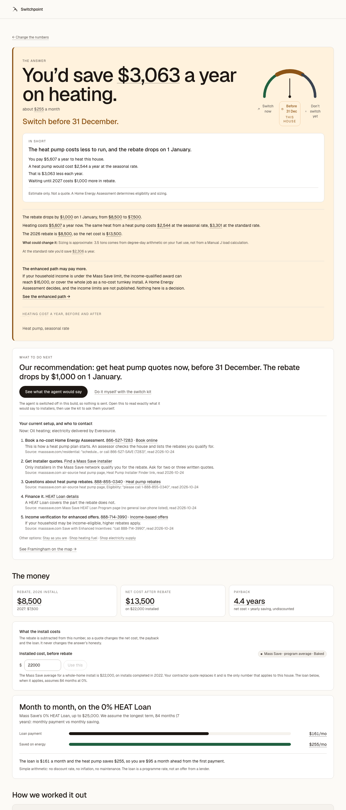

## Propane, National Grid, standard income {#propane-national-grid}

Propane home in a National Grid town (smaller seasonal rate cut), numeric 13-month usage table.

- Town: Worcester. Fuel: propane. Install year: 2026. Quote: none (Mass Save average).
- Electric bill: [PNG](../../public/demo-bills/scenarios/propane-national-grid/electric.png) · [PDF](../../public/demo-bills/scenarios/propane-national-grid/electric.pdf) · [reader JSON](../../public/demo-bills/scenarios/propane-national-grid/expected/electric.json)
- Heating bill: [PNG](../../public/demo-bills/scenarios/propane-national-grid/heating.png) · [PDF](../../public/demo-bills/scenarios/propane-national-grid/heating.pdf) · [reader JSON](../../public/demo-bills/scenarios/propane-national-grid/expected/heating.json)
- Verdict link: `/verdict?fuel=propane&units=1030&price=3.91&town=Worcester&tier=whole&year=2026&inc=no&m=degree_days&mc=0.7&mn=Scaled+from+the+1%2C050+degree+days+printed+on+the+ticket+to+a+5%2C694+degree-day+heating+season.&ut=national_grid&er=0.311&li=0&demo=1`
- Expected: Before 31 Dec, save_before_deadline, recommendation `quotes`, choices STAY / SHOP_FUEL / SHOP_SUPPLY / SWITCH_HEAT_PUMP.
- Shown: **Before 31 Dec**, action "Switch before 31 December.", tone `deadline`. Match: ok.
- Headline: You’d save $1,671 a year on heating.
- What to do next: Our recommendation: get heat pump quotes now, before 31 December. The rebate drops by $750 on 1 January.
- Contacts: Now: Propane heating; electricity delivered by National Grid. Book a no-cost Home Energy Assessment. 866-527-7283 · Book online This is how a heat pump plan starts. An assessor checks the house and lists the rebates you qualify for. Source: masssave.com/residential: "schedule... or call 866-527-SAVE (7283)", read 2026-10-24 Get installer quotes. Find a Mass Save installer Only installers in the Mass Save network qualify you for the rebate. Ask for two or three written quotes. Source: masssave.com air-source heat pump page, Heat Pump Installer Finder link, read 2026-10-24 Questions about heat pump rebates. 888-855-0340 · Heat pump rebates Source: masssave.com air-source heat pump page, Eligibility: "please call 1-888-855-0340", read 2026-10-24 Finance it. HEAT Loan details A HEAT Loan covers the part the rebate does not. Source: masssave.com Mass Save HEAT Loan Program page (no general loan phone listed), read 2026-10-24 Income verification for enhanced offers. 888-714-3990 · Income-based offers If your household may be income-eligible, higher rebates apply. Source: masssave.com Save with Enhanced Incentives: "call 888-714-3990", read 2026-10-24 Other options: Stay as you are · Shop heating fuel · Shop electricity supply See Worcester on the map →
- The money: Rebate, 2026 install $6,625 2027: $5,875 Net cost after rebate $15,375 on $22,000 installed Payback 9.2 years net cost ÷ yearly saving, undiscounted What the install costs The rebate is subtracted from this number, so a quote changes the net cost, the payback and the loan. It never changes the answer’s honesty. Installed cost, before rebate Mass Save · program average · Baked $ Use this The Mass S

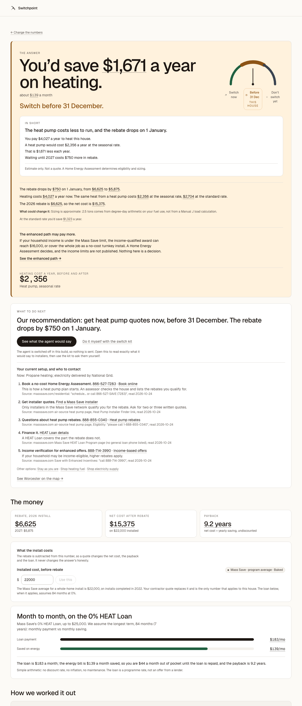

## Natural gas, standard rate {#gas-do-not-switch}

Gas home on R-3: gas is cheap, so a heat pump costs more to run and the answer is stay. Gas has no fuel to shop.

- Town: Cambridge. Fuel: gas. Install year: 2026. Quote: none (Mass Save average).
- Electric bill: [PNG](../../public/demo-bills/scenarios/gas-do-not-switch/electric.png) · [PDF](../../public/demo-bills/scenarios/gas-do-not-switch/electric.pdf) · [reader JSON](../../public/demo-bills/scenarios/gas-do-not-switch/expected/electric.json)
- Heating bill: [PNG](../../public/demo-bills/scenarios/gas-do-not-switch/heating.png) · [PDF](../../public/demo-bills/scenarios/gas-do-not-switch/heating.pdf) · [reader JSON](../../public/demo-bills/scenarios/gas-do-not-switch/expected/heating.json)
- Verdict link: `/verdict?fuel=gas&units=965&price=1.70&town=Cambridge&tier=whole&year=2026&inc=unsure&m=hdd_scaled&mc=0.5&mn=January+is+19.7%25+of+a+Massachusetts+heating+year%2C+so+this+bill+implies+this+year.&ut=eversource&er=0.305&li=0&demo=1`
- Expected: Don’t switch yet, lose_stay, recommendation `stay`, choices STAY / SHOP_SUPPLY / SWITCH_HEAT_PUMP.
- Shown: **Don’t switch yet**, action "Stay with what you have.", tone `hold`. Match: ok.
- Headline: You’d pay $452 a year more.
- What to do next: Our recommendation: stay with what you have. Check again in January 2027, when prices and rebates reset.
- Contacts: Now: Gas heating; electricity delivered by Eversource. Ask Eversource about your bill. Contact page Rate plans and the winter heat pump rate are set by your utility. Source: eversource.com residential contact page: phone numbers show by town, hours Mon-Fri 8 a.m.-6 p.m. ET, read 2026-10-24 Compare electricity supply. Energy Switch Massachusetts Delivery stays with your utility. Supply is the part you can shop. Source: energyswitchma.gov, the Department of Public Utilities supply-shopping site (no phone on the page), read 2026-10-24 Other options: Shop electricity supply · Get heat pump quotes See Cambridge on the map →
- The money: Rebate, 2026 install $7,950 2027: $7,050 Net cost after rebate $14,050 on $22,000 installed Payback Doesn't pay back running costs go up, not down What the install costs The rebate is subtracted from this number, so a quote changes the net cost, the payback and the loan. It never changes the answer’s honesty. Installed cost, before rebate Mass Save · program average · Baked $ Use this The Mass Sav

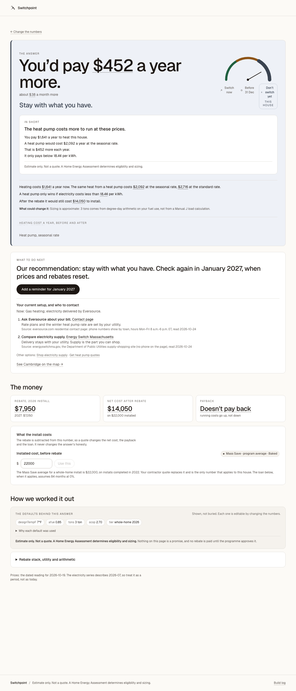

## Natural gas on a discount rate (R-4) {#gas-discount-rate}

Gas bill on R-4 with a discount line: income reads yes, but the enhanced tier is closed to gas, so the app says so out loud.

- Town: Boston. Fuel: gas. Install year: 2026. Quote: none (Mass Save average).
- Electric bill: [PNG](../../public/demo-bills/scenarios/gas-discount-rate/electric.png) · [PDF](../../public/demo-bills/scenarios/gas-discount-rate/electric.pdf) · [reader JSON](../../public/demo-bills/scenarios/gas-discount-rate/expected/electric.json)
- Heating bill: [PNG](../../public/demo-bills/scenarios/gas-discount-rate/heating.png) · [PDF](../../public/demo-bills/scenarios/gas-discount-rate/heating.pdf) · [reader JSON](../../public/demo-bills/scenarios/gas-discount-rate/expected/heating.json)
- Verdict link: `/verdict?fuel=gas&units=965&price=1.70&town=Boston&tier=whole&year=2026&inc=yes&m=hdd_scaled&mc=0.5&mn=January+is+19.7%25+of+a+Massachusetts+heating+year%2C+so+this+bill+implies+this+year.&ut=eversource&er=0.305&li=1&demo=1`
- Expected: Don’t switch yet, lose_stay, recommendation `stay`, choices STAY / SHOP_SUPPLY / SWITCH_HEAT_PUMP.
- Shown: **Don’t switch yet**, action "Stay with what you have.", tone `hold`. Match: ok.
- Headline: You’d pay $452 a year more.
- What to do next: Our recommendation: stay with what you have. Check again in January 2027, when prices and rebates reset.
- Contacts: Now: Gas heating; electricity delivered by Eversource. Ask Eversource about your bill. Contact page Rate plans and the winter heat pump rate are set by your utility. Source: eversource.com residential contact page: phone numbers show by town, hours Mon-Fri 8 a.m.-6 p.m. ET, read 2026-10-24 Compare electricity supply. Energy Switch Massachusetts Delivery stays with your utility. Supply is the part you can shop. Source: energyswitchma.gov, the Department of Public Utilities supply-shopping site (no phone on the page), read 2026-10-24 Other options: Shop electricity supply · Get heat pump quotes See Boston on the map →
- The money: Rebate, 2026 install $7,950 2027: $7,050 Net cost after rebate $14,050 on $22,000 installed Payback Doesn't pay back running costs go up, not down What the install costs The rebate is subtracted from this number, so a quote changes the net cost, the payback and the loan. It never changes the answer’s honesty. Installed cost, before rebate Mass Save · program average · Baked $ Use this The Mass Sav

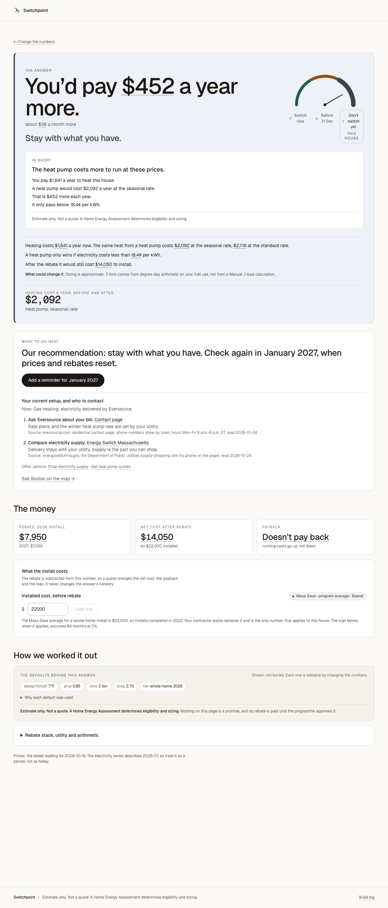

## Electric resistance heat {#electric-resistance}

The electric bill is the heating bill: baseload comes off the printed history and the remainder is priced as resistance heat.

- Town: Springfield. Fuel: resistance. Install year: 2026. Quote: none (Mass Save average).
- Electric bill: [PNG](../../public/demo-bills/scenarios/electric-resistance/electric.png) · [PDF](../../public/demo-bills/scenarios/electric-resistance/electric.pdf) · [reader JSON](../../public/demo-bills/scenarios/electric-resistance/expected/electric.json)
- Heating bill: the electric bill is the heating bill (read once as electricity, once as heat).
- Verdict link: `/verdict?fuel=resistance&units=12600&price=0.305&town=Springfield&tier=whole&year=2026&inc=no&m=printed_history&mc=0.75&mn=Read+from+the+bar+chart+on+the+document%3A+12+months+of+usage%2C+added+up.+Bars+are+read+by+eye%2C+so+treat+it+as+close%2C+not+exact.&ut=eversource&er=0.305&li=0&demo=1`
- Expected: Before 31 Dec, save_before_deadline, recommendation `quotes`, choices STAY / SHOP_SUPPLY / SWITCH_HEAT_PUMP.
- Shown: **Before 31 Dec**, action "Switch before 31 December.", tone `deadline`. Match: ok.
- Headline: You’d save $2,746 a year on heating.
- What to do next: Our recommendation: get heat pump quotes now, before 31 December. The rebate drops by $450 on 1 January.
- Contacts: Now: Electric resistance heating; electricity delivered by Eversource. Book a no-cost Home Energy Assessment. 866-527-7283 · Book online This is how a heat pump plan starts. An assessor checks the house and lists the rebates you qualify for. Source: masssave.com/residential: "schedule... or call 866-527-SAVE (7283)", read 2026-10-24 Get installer quotes. Find a Mass Save installer Only installers in the Mass Save network qualify you for the rebate. Ask for two or three written quotes. Source: masssave.com air-source heat pump page, Heat Pump Installer Finder link, read 2026-10-24 Questions about heat pump rebates. 888-855-0340 · Heat pump rebates Source: masssave.com air-source heat pump page, Eligibility: "please call 1-888-855-0340", read 2026-10-24 Finance it. HEAT Loan details A HEAT Loan covers the part the rebate does not. Source: masssave.com Mass Save HEAT Loan Program page (no general loan phone listed), read 2026-10-24 Income verification for enhanced offers. 888-714-3990 · Income-based offers If your household may be income-eligible, higher rebates apply. Source: masssave.com Save with Enhanced Incentives: "call 888-714-3990", read 2026-10-24 Other options: Stay as you are · Shop electricity supply See Springfield on the map →
- The money: Rebate, 2026 install $3,975 2027: $3,525 Net cost after rebate $18,025 on $22,000 installed Payback 6.6 years net cost ÷ yearly saving, undiscounted What the install costs The rebate is subtracted from this number, so a quote changes the net cost, the payback and the loan. It never changes the answer’s honesty. Installed cost, before rebate Mass Save · program average · Baked $ Use this The Mass S

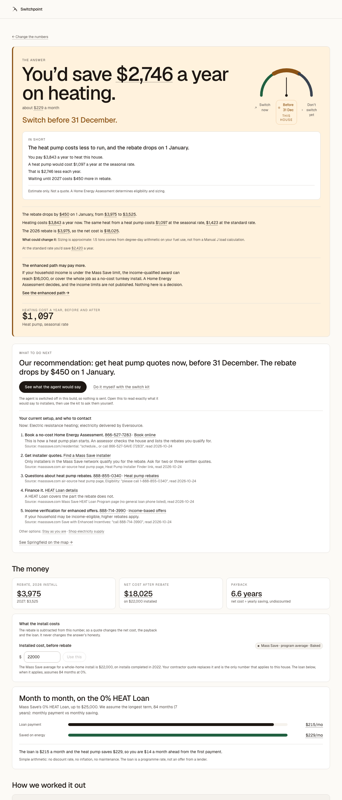

## Municipal light plant town (Wellesley) {#municipal-light-plant}

A town-owned utility: no Mass Save electric rebate exists, so the screen refuses to print a rebate and recommends staying.

- Town: Wellesley. Fuel: oil. Install year: 2026. Quote: none (Mass Save average).
- Electric bill: [PNG](../../public/demo-bills/scenarios/municipal-light-plant/electric.png) · [PDF](../../public/demo-bills/scenarios/municipal-light-plant/electric.pdf) · [reader JSON](../../public/demo-bills/scenarios/municipal-light-plant/expected/electric.json)
- Heating bill: [PNG](../../public/demo-bills/scenarios/municipal-light-plant/heating.png) · [PDF](../../public/demo-bills/scenarios/municipal-light-plant/heating.pdf) · [reader JSON](../../public/demo-bills/scenarios/municipal-light-plant/expected/heating.json)
- Verdict link: `/verdict?fuel=oil&units=900&price=6.23&town=Wellesley&tier=whole&year=2026&inc=unsure&m=degree_days&mc=0.7&mn=Scaled+from+the+886+degree+days+printed+on+the+ticket+to+a+5%2C694+degree-day+heating+season.&ut=municipal&er=0.231&li=0&demo=1`
- Expected: Refusal (no verdict shown), save_before_deadline, recommendation `stay`, choices STAY / SHOP_FUEL / SWITCH_HEAT_PUMP.
- Shown: **Refusal (no verdict shown)**, tone `hold`. Match: ok.
- Headline: Mass Save rebates do not apply at this address.
- What to do next: Our recommendation: stay with what you have. Check again in January 2027, when prices and rebates reset.
- Contacts: Now: Oil heating; electricity delivered by your municipal light plant. Contact your municipal light plant. Mass Save rebates do not apply to light plant customers. Ask the light plant which efficiency or heat pump programs it runs. Its number is on your electric bill. Ask your dealer for a price. Ask for today's price per gallon in writing before your next delivery. Other options: Shop heating fuel · Get heat pump quotes See Wellesley on the map →
- The money: Rebate, 2026 install not available municipal light plant Net cost after rebate not quoted rebate does not exist here Payback not quoted depends on a rebate

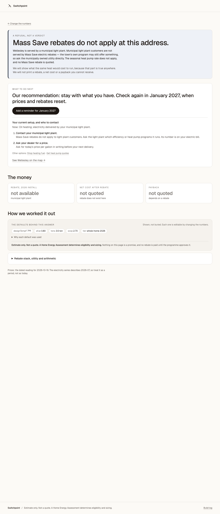

## Mixed-utility town, bill names Eversource {#mixed-town-bill-says-eversource}

Westport is served by two sponsors. An Eversource bill settles it, so the rebate and the supply comparison both apply.

- Town: Westport. Fuel: oil. Install year: 2026. Quote: none (Mass Save average).
- Electric bill: [PNG](../../public/demo-bills/scenarios/mixed-town-bill-says-eversource/electric.png) · [PDF](../../public/demo-bills/scenarios/mixed-town-bill-says-eversource/electric.pdf) · [reader JSON](../../public/demo-bills/scenarios/mixed-town-bill-says-eversource/expected/electric.json)
- Heating bill: [PNG](../../public/demo-bills/scenarios/mixed-town-bill-says-eversource/heating.png) · [PDF](../../public/demo-bills/scenarios/mixed-town-bill-says-eversource/heating.pdf) · [reader JSON](../../public/demo-bills/scenarios/mixed-town-bill-says-eversource/expected/heating.json)
- Verdict link: `/verdict?fuel=oil&units=900&price=6.23&town=Westport&tier=whole&year=2026&inc=no&m=degree_days&mc=0.7&mn=Scaled+from+the+886+degree+days+printed+on+the+ticket+to+a+5%2C694+degree-day+heating+season.&ut=eversource&er=0.305&li=0&demo=1`
- Expected: Before 31 Dec, save_before_deadline, recommendation `quotes`, choices STAY / SHOP_FUEL / SHOP_SUPPLY / SWITCH_HEAT_PUMP.
- Shown: **Before 31 Dec**, action "Switch before 31 December.", tone `deadline`. Match: ok.
- Headline: You’d save $2,306 a year on heating.
- What to do next: Our recommendation: get heat pump quotes now, before 31 December. The rebate drops by $1,000 on 1 January.
- Contacts: Now: Oil heating; electricity delivered by Eversource. Book a no-cost Home Energy Assessment. 866-527-7283 · Book online This is how a heat pump plan starts. An assessor checks the house and lists the rebates you qualify for. Source: masssave.com/residential: "schedule... or call 866-527-SAVE (7283)", read 2026-10-24 Get installer quotes. Find a Mass Save installer Only installers in the Mass Save network qualify you for the rebate. Ask for two or three written quotes. Source: masssave.com air-source heat pump page, Heat Pump Installer Finder link, read 2026-10-24 Questions about heat pump rebates. 888-855-0340 · Heat pump rebates Source: masssave.com air-source heat pump page, Eligibility: "please call 1-888-855-0340", read 2026-10-24 Finance it. HEAT Loan details A HEAT Loan covers the part the rebate does not. Source: masssave.com Mass Save HEAT Loan Program page (no general loan phone listed), read 2026-10-24 Income verification for enhanced offers. 888-714-3990 · Income-based offers If your household may be income-eligible, higher rebates apply. Source: masssave.com Save with Enhanced Incentives: "call 888-714-3990", read 2026-10-24 Other options: Stay as you are · Shop heating fuel · Shop electricity supply See Westport on the map →
- The money: Rebate, 2026 install $8,500 2027: $7,500 Net cost after rebate $13,500 on $22,000 installed Payback 5.9 years net cost ÷ yearly saving, undiscounted What the install costs The rebate is subtracted from this number, so a quote changes the net cost, the payback and the loan. It never changes the answer’s honesty. Installed cost, before rebate Mass Save · program average · Baked $ Use this The Mass S

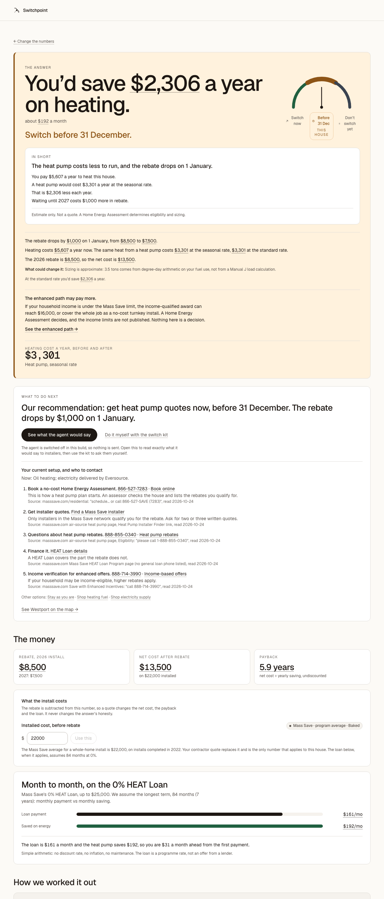

## Mixed-utility town, bill names the light plant {#mixed-town-bill-says-municipal}

Lakeville has a light plant and Eversource. A light-plant bill settles it the other way: no Mass Save rebate.

- Town: Lakeville. Fuel: oil. Install year: 2026. Quote: none (Mass Save average).
- Electric bill: [PNG](../../public/demo-bills/scenarios/mixed-town-bill-says-municipal/electric.png) · [PDF](../../public/demo-bills/scenarios/mixed-town-bill-says-municipal/electric.pdf) · [reader JSON](../../public/demo-bills/scenarios/mixed-town-bill-says-municipal/expected/electric.json)
- Heating bill: [PNG](../../public/demo-bills/scenarios/mixed-town-bill-says-municipal/heating.png) · [PDF](../../public/demo-bills/scenarios/mixed-town-bill-says-municipal/heating.pdf) · [reader JSON](../../public/demo-bills/scenarios/mixed-town-bill-says-municipal/expected/heating.json)
- Verdict link: `/verdict?fuel=oil&units=900&price=6.23&town=Lakeville&tier=whole&year=2026&inc=unsure&m=degree_days&mc=0.7&mn=Scaled+from+the+886+degree+days+printed+on+the+ticket+to+a+5%2C694+degree-day+heating+season.&ut=municipal&er=0.239&li=0&demo=1`
- Expected: Refusal (no verdict shown), save_before_deadline, recommendation `stay`, choices STAY / SHOP_FUEL / SWITCH_HEAT_PUMP.
- Shown: **Refusal (no verdict shown)**, tone `hold`. Match: ok.
- Headline: Mass Save rebates do not apply at this address.
- What to do next: Our recommendation: stay with what you have. Check again in January 2027, when prices and rebates reset.
- Contacts: Now: Oil heating; electricity delivered by your municipal light plant. Contact your municipal light plant. Mass Save rebates do not apply to light plant customers. Ask the light plant which efficiency or heat pump programs it runs. Its number is on your electric bill. Ask your dealer for a price. Ask for today's price per gallon in writing before your next delivery. Other options: Shop heating fuel · Get heat pump quotes See Lakeville on the map →
- The money: Rebate, 2026 install not available municipal light plant Net cost after rebate not quoted rebate does not exist here Payback not quoted depends on a rebate

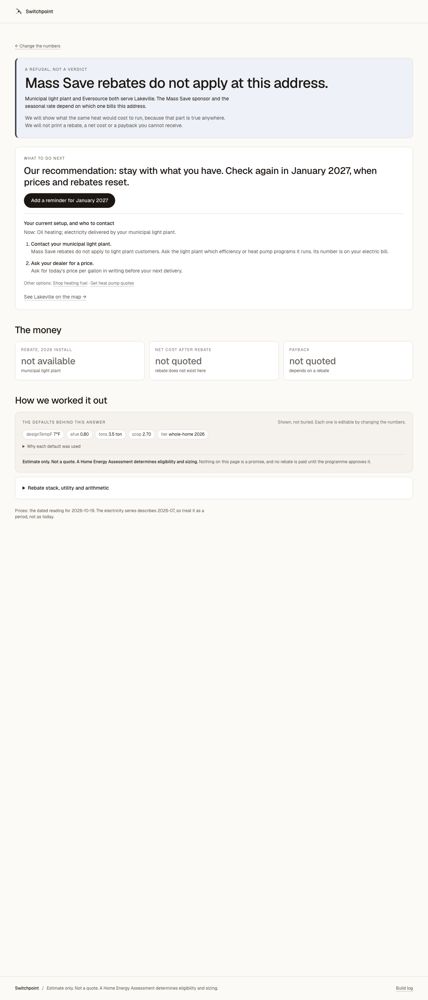

## Competitive supplier above Basic Service {#competitive-supplier}

Eversource bill with a fictional competitive supplier at 21.9 cents against Basic Service: the household rate is higher and shopping supply is on the table.

- Town: Boston. Fuel: oil. Install year: 2026. Quote: none (Mass Save average).
- Electric bill: [PNG](../../public/demo-bills/scenarios/competitive-supplier/electric.png) · [PDF](../../public/demo-bills/scenarios/competitive-supplier/electric.pdf) · [reader JSON](../../public/demo-bills/scenarios/competitive-supplier/expected/electric.json)
- Heating bill: [PNG](../../public/demo-bills/scenarios/competitive-supplier/heating.png) · [PDF](../../public/demo-bills/scenarios/competitive-supplier/heating.pdf) · [reader JSON](../../public/demo-bills/scenarios/competitive-supplier/expected/heating.json)
- Verdict link: `/verdict?fuel=oil&units=900&price=6.23&town=Boston&tier=whole&year=2026&inc=no&m=degree_days&mc=0.7&mn=Scaled+from+the+886+degree+days+printed+on+the+ticket+to+a+5%2C694+degree-day+heating+season.&ut=eversource&er=0.349&li=0&demo=1`
- Expected: Before 31 Dec, save_before_deadline, recommendation `quotes`, choices STAY / SHOP_FUEL / SHOP_SUPPLY / SWITCH_HEAT_PUMP.
- Shown: **Before 31 Dec**, action "Switch before 31 December.", tone `deadline`. Match: ok.
- Headline: You’d save $2,587 a year on heating.
- What to do next: Our recommendation: get heat pump quotes now, before 31 December. The rebate drops by $1,000 on 1 January.
- Contacts: Now: Oil heating; electricity delivered by Eversource. Book a no-cost Home Energy Assessment. 866-527-7283 · Book online This is how a heat pump plan starts. An assessor checks the house and lists the rebates you qualify for. Source: masssave.com/residential: "schedule... or call 866-527-SAVE (7283)", read 2026-10-24 Get installer quotes. Find a Mass Save installer Only installers in the Mass Save network qualify you for the rebate. Ask for two or three written quotes. Source: masssave.com air-source heat pump page, Heat Pump Installer Finder link, read 2026-10-24 Questions about heat pump rebates. 888-855-0340 · Heat pump rebates Source: masssave.com air-source heat pump page, Eligibility: "please call 1-888-855-0340", read 2026-10-24 Finance it. HEAT Loan details A HEAT Loan covers the part the rebate does not. Source: masssave.com Mass Save HEAT Loan Program page (no general loan phone listed), read 2026-10-24 Income verification for enhanced offers. 888-714-3990 · Income-based offers If your household may be income-eligible, higher rebates apply. Source: masssave.com Save with Enhanced Incentives: "call 888-714-3990", read 2026-10-24 Other options: Stay as you are · Shop heating fuel · Shop electricity supply See Boston on the map →
- The money: Rebate, 2026 install $8,500 2027: $7,500 Net cost after rebate $13,500 on $22,000 installed Payback 5.2 years net cost ÷ yearly saving, undiscounted What the install costs The rebate is subtracted from this number, so a quote changes the net cost, the payback and the loan. It never changes the answer’s honesty. Installed cost, before rebate Mass Save · program average · Baked $ Use this The Mass S

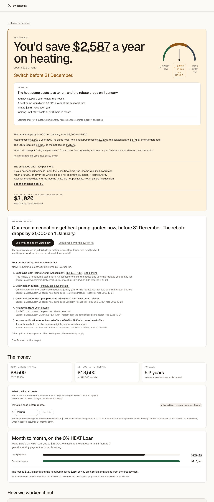

## High install quote, above the $25,000 loan cap {#high-quote-over-loan-cap}

A contractor quote of $38,000: the rebate does not cover it and the 0% HEAT Loan stops at $25,000, so a remainder is left. Savings still pay it back inside 15 years.

- Town: Framingham. Fuel: oil. Install year: 2026. Quote: $38,000.
- Electric bill: [PNG](../../public/demo-bills/scenarios/high-quote-over-loan-cap/electric.png) · [PDF](../../public/demo-bills/scenarios/high-quote-over-loan-cap/electric.pdf) · [reader JSON](../../public/demo-bills/scenarios/high-quote-over-loan-cap/expected/electric.json)
- Heating bill: [PNG](../../public/demo-bills/scenarios/high-quote-over-loan-cap/heating.png) · [PDF](../../public/demo-bills/scenarios/high-quote-over-loan-cap/heating.pdf) · [reader JSON](../../public/demo-bills/scenarios/high-quote-over-loan-cap/expected/heating.json)
- Verdict link: `/verdict?fuel=oil&units=900&price=6.23&town=Framingham&tier=whole&year=2026&inc=no&m=degree_days&mc=0.7&mn=Scaled+from+the+886+degree+days+printed+on+the+ticket+to+a+5%2C694+degree-day+heating+season.&ut=eversource&er=0.305&li=0&ic=38000&demo=1`
- Expected: Before 31 Dec, save_before_deadline, recommendation `quotes`, choices STAY / SHOP_FUEL / SHOP_SUPPLY / SWITCH_HEAT_PUMP.
- Shown: **Before 31 Dec**, action "Switch before 31 December.", tone `deadline`. Match: ok.
- Headline: You’d save $3,063 a year on heating.
- What to do next: Our recommendation: get heat pump quotes now, before 31 December. The rebate drops by $1,000 on 1 January.
- Contacts: Now: Oil heating; electricity delivered by Eversource. Book a no-cost Home Energy Assessment. 866-527-7283 · Book online This is how a heat pump plan starts. An assessor checks the house and lists the rebates you qualify for. Source: masssave.com/residential: "schedule... or call 866-527-SAVE (7283)", read 2026-10-24 Get installer quotes. Find a Mass Save installer Only installers in the Mass Save network qualify you for the rebate. Ask for two or three written quotes. Source: masssave.com air-source heat pump page, Heat Pump Installer Finder link, read 2026-10-24 Questions about heat pump rebates. 888-855-0340 · Heat pump rebates Source: masssave.com air-source heat pump page, Eligibility: "please call 1-888-855-0340", read 2026-10-24 Finance it. HEAT Loan details A HEAT Loan covers the part the rebate does not. Source: masssave.com Mass Save HEAT Loan Program page (no general loan phone listed), read 2026-10-24 Income verification for enhanced offers. 888-714-3990 · Income-based offers If your household may be income-eligible, higher rebates apply. Source: masssave.com Save with Enhanced Incentives: "call 888-714-3990", read 2026-10-24 Other options: Stay as you are · Shop heating fuel · Shop electricity supply See Framingham on the map →
- The money: Rebate, 2026 install $8,500 2027: $7,500 Net cost after rebate $29,500 on $38,000 installed Payback 9.6 years net cost ÷ yearly saving, undiscounted What the install costs The rebate is subtracted from this number, so a quote changes the net cost, the payback and the loan. It never changes the answer’s honesty. Installed cost, before rebate Your quote · You entered $ Use this Back to the $22,000 a

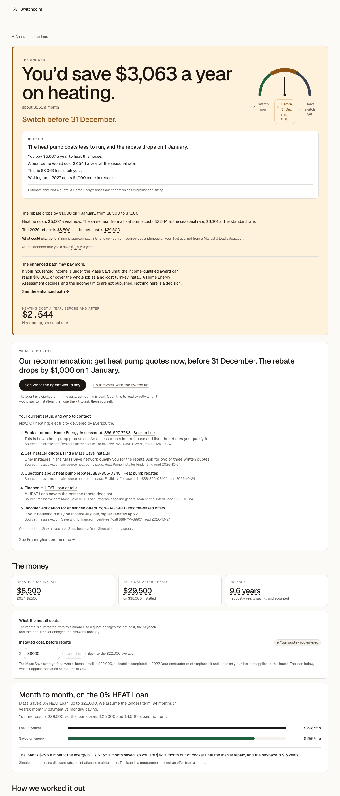

## Very high install quote, payback past 15 years {#very-high-quote-payback-fails}

A $60,000 quote: savings are real but take more than 15 years to repay it, so the verdict is wait.

- Town: Framingham. Fuel: oil. Install year: 2026. Quote: $60,000.
- Electric bill: [PNG](../../public/demo-bills/scenarios/very-high-quote-payback-fails/electric.png) · [PDF](../../public/demo-bills/scenarios/very-high-quote-payback-fails/electric.pdf) · [reader JSON](../../public/demo-bills/scenarios/very-high-quote-payback-fails/expected/electric.json)
- Heating bill: [PNG](../../public/demo-bills/scenarios/very-high-quote-payback-fails/heating.png) · [PDF](../../public/demo-bills/scenarios/very-high-quote-payback-fails/heating.pdf) · [reader JSON](../../public/demo-bills/scenarios/very-high-quote-payback-fails/expected/heating.json)
- Verdict link: `/verdict?fuel=oil&units=900&price=6.23&town=Framingham&tier=whole&year=2026&inc=no&m=degree_days&mc=0.7&mn=Scaled+from+the+886+degree+days+printed+on+the+ticket+to+a+5%2C694+degree-day+heating+season.&ut=eversource&er=0.305&li=0&ic=60000&demo=1`
- Expected: Don’t switch yet, save_but_wait, recommendation `stay`, choices STAY / SHOP_FUEL / SHOP_SUPPLY / SWITCH_HEAT_PUMP.
- Shown: **Don’t switch yet**, action "Wait.", tone `hold`. Match: ok.
- Headline: You’d save $3,063 a year, but it takes 16.8 years to pay back.
- What to do next: Our recommendation: stay with what you have. Check again in January 2027, when prices and rebates reset.
- Contacts: Now: Oil heating; electricity delivered by Eversource. Ask Eversource about your bill. Contact page Rate plans and the winter heat pump rate are set by your utility. Source: eversource.com residential contact page: phone numbers show by town, hours Mon-Fri 8 a.m.-6 p.m. ET, read 2026-10-24 Compare electricity supply. Energy Switch Massachusetts Delivery stays with your utility. Supply is the part you can shop. Source: energyswitchma.gov, the Department of Public Utilities supply-shopping site (no phone on the page), read 2026-10-24 Ask your dealer for a price. Ask for today's price per gallon in writing before your next delivery. Other options: Shop heating fuel · Shop electricity supply · Get heat pump quotes See Framingham on the map →
- The money: Rebate, 2026 install $8,500 2027: $7,500 Net cost after rebate $51,500 on $60,000 installed Payback 16.8 years past the 15-year limit we use, so the verdict is "not yet" What the install costs The rebate is subtracted from this number, so a quote changes the net cost, the payback and the loan. It never changes the answer’s honesty. Installed cost, before rebate Your quote · You entered $ Use this 

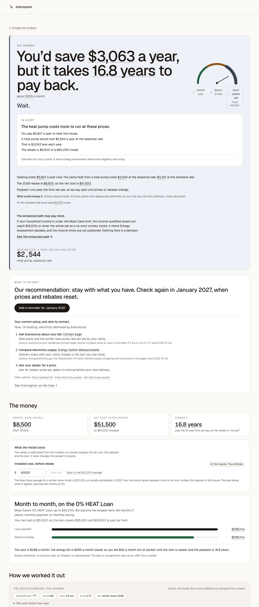

## Very low install quote, rebate covers it {#low-quote-rebate-covers}

Income-qualified household with a $9,000 quote: the enhanced rebate is the lower of cost and cap, so the net cost is zero.

- Town: Framingham. Fuel: oil. Install year: 2026. Quote: $9,000.
- Electric bill: [PNG](../../public/demo-bills/scenarios/low-quote-rebate-covers/electric.png) · [PDF](../../public/demo-bills/scenarios/low-quote-rebate-covers/electric.pdf) · [reader JSON](../../public/demo-bills/scenarios/low-quote-rebate-covers/expected/electric.json)
- Heating bill: [PNG](../../public/demo-bills/scenarios/low-quote-rebate-covers/heating.png) · [PDF](../../public/demo-bills/scenarios/low-quote-rebate-covers/heating.pdf) · [reader JSON](../../public/demo-bills/scenarios/low-quote-rebate-covers/expected/heating.json)
- Verdict link: `/verdict?fuel=oil&units=900&price=6.23&town=Framingham&tier=enhanced&year=2026&inc=yes&m=degree_days&mc=0.7&mn=Scaled+from+the+886+degree+days+printed+on+the+ticket+to+a+5%2C694+degree-day+heating+season.&ut=eversource&er=0.25&li=1&ic=9000&demo=1`
- Expected: Switch now, save_switch, recommendation `quotes`, choices STAY / SHOP_FUEL / SHOP_SUPPLY / SWITCH_HEAT_PUMP.
- Shown: **Switch now**, action "Switch.", tone `switch`. Match: ok.
- Headline: You’d save $3,659 a year on heating.
- What to do next: Our recommendation: get heat pump quotes now
- Contacts: Now: Oil heating; electricity delivered by Eversource. Book a no-cost Home Energy Assessment. 866-527-7283 · Book online This is how a heat pump plan starts. An assessor checks the house and lists the rebates you qualify for. Source: masssave.com/residential: "schedule... or call 866-527-SAVE (7283)", read 2026-10-24 Get installer quotes. Find a Mass Save installer Only installers in the Mass Save network qualify you for the rebate. Ask for two or three written quotes. Source: masssave.com air-source heat pump page, Heat Pump Installer Finder link, read 2026-10-24 Questions about heat pump rebates. 888-855-0340 · Heat pump rebates Source: masssave.com air-source heat pump page, Eligibility: "please call 1-888-855-0340", read 2026-10-24 Finance it. HEAT Loan details A HEAT Loan covers the part the rebate does not. Source: masssave.com Mass Save HEAT Loan Program page (no general loan phone listed), read 2026-10-24 Income verification for enhanced offers. 888-714-3990 · Income-based offers If your household may be income-eligible, higher rebates apply. Source: masssave.com Save with Enhanced Incentives: "call 888-714-3990", read 2026-10-24 Other options: Stay as you are · Shop heating fuel · Shop electricity supply See Framingham on the map →
- The money: Rebate, 2026 install $9,000 enhanced rule: lower of install cost ($9,000) and the cap · 2027: $9,000 Net cost after rebate $0 on $9,000 installed Payback Pays for itself immediately the rebate covers the whole install cost What the install costs The rebate is subtracted from this number, so a quote changes the net cost, the payback and the loan. It never changes the answer’s honesty. Installed cos

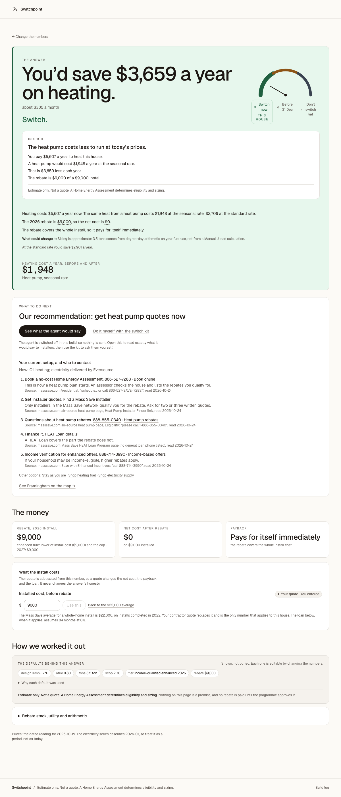

## Unitil town (Fitchburg), oil {#unitil-oil}

Unitil sponsors the town: the Mass Save seasonal heat-pump rate cut is the larger $0.07 one.

- Town: Fitchburg. Fuel: oil. Install year: 2026. Quote: none (Mass Save average).
- Electric bill: [PNG](../../public/demo-bills/scenarios/unitil-oil/electric.png) · [PDF](../../public/demo-bills/scenarios/unitil-oil/electric.pdf) · [reader JSON](../../public/demo-bills/scenarios/unitil-oil/expected/electric.json)
- Heating bill: [PNG](../../public/demo-bills/scenarios/unitil-oil/heating.png) · [PDF](../../public/demo-bills/scenarios/unitil-oil/heating.pdf) · [reader JSON](../../public/demo-bills/scenarios/unitil-oil/expected/heating.json)
- Verdict link: `/verdict?fuel=oil&units=900&price=6.23&town=Fitchburg&tier=whole&year=2026&inc=no&m=degree_days&mc=0.7&mn=Scaled+from+the+886+degree+days+printed+on+the+ticket+to+a+5%2C694+degree-day+heating+season.&ut=unitil&er=0.299&li=0&demo=1`
- Expected: Before 31 Dec, save_before_deadline, recommendation `quotes`, choices STAY / SHOP_FUEL / SHOP_SUPPLY / SWITCH_HEAT_PUMP.
- Shown: **Before 31 Dec**, action "Switch before 31 December.", tone `deadline`. Match: ok.
- Headline: You’d save $3,128 a year on heating.
- What to do next: Our recommendation: get heat pump quotes now, before 31 December. The rebate drops by $900 on 1 January.
- Contacts: Now: Oil heating; electricity delivered by Unitil. Book a no-cost Home Energy Assessment. 866-527-7283 · Book online This is how a heat pump plan starts. An assessor checks the house and lists the rebates you qualify for. Source: masssave.com/residential: "schedule... or call 866-527-SAVE (7283)", read 2026-10-24 Get installer quotes. Find a Mass Save installer Only installers in the Mass Save network qualify you for the rebate. Ask for two or three written quotes. Source: masssave.com air-source heat pump page, Heat Pump Installer Finder link, read 2026-10-24 Questions about heat pump rebates. 888-855-0340 · Heat pump rebates Source: masssave.com air-source heat pump page, Eligibility: "please call 1-888-855-0340", read 2026-10-24 Finance it. HEAT Loan details A HEAT Loan covers the part the rebate does not. Source: masssave.com Mass Save HEAT Loan Program page (no general loan phone listed), read 2026-10-24 Income verification for enhanced offers. 888-714-3990 · Income-based offers If your household may be income-eligible, higher rebates apply. Source: masssave.com Save with Enhanced Incentives: "call 888-714-3990", read 2026-10-24 Other options: Stay as you are · Shop heating fuel · Shop electricity supply See Fitchburg on the map →
- The money: Rebate, 2026 install $7,950 2027: $7,050 Net cost after rebate $14,050 on $22,000 installed Payback 4.5 years net cost ÷ yearly saving, undiscounted What the install costs The rebate is subtracted from this number, so a quote changes the net cost, the payback and the loan. It never changes the answer’s honesty. Installed cost, before rebate Mass Save · program average · Baked $ Use this The Mass S

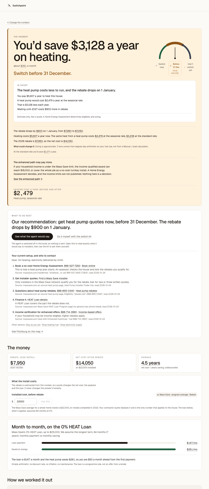

## Cape Light Compact town (Truro), oil {#cape-light-oil}

Cape Light Compact is a Mass Save sponsor but has no published seasonal heat-pump rate, so none is applied.

- Town: Truro. Fuel: oil. Install year: 2026. Quote: none (Mass Save average).
- Electric bill: [PNG](../../public/demo-bills/scenarios/cape-light-oil/electric.png) · [PDF](../../public/demo-bills/scenarios/cape-light-oil/electric.pdf) · [reader JSON](../../public/demo-bills/scenarios/cape-light-oil/expected/electric.json)
- Heating bill: [PNG](../../public/demo-bills/scenarios/cape-light-oil/heating.png) · [PDF](../../public/demo-bills/scenarios/cape-light-oil/heating.pdf) · [reader JSON](../../public/demo-bills/scenarios/cape-light-oil/expected/heating.json)
- Verdict link: `/verdict?fuel=oil&units=900&price=6.23&town=Truro&tier=whole&year=2026&inc=no&m=degree_days&mc=0.7&mn=Scaled+from+the+886+degree+days+printed+on+the+ticket+to+a+5%2C694+degree-day+heating+season.&ut=eversource&er=0.305&li=0&demo=1`
- Expected: Before 31 Dec, save_before_deadline, recommendation `quotes`, choices STAY / SHOP_FUEL / SHOP_SUPPLY / SWITCH_HEAT_PUMP.
- Shown: **Before 31 Dec**, action "Switch before 31 December.", tone `deadline`. Match: ok.
- Headline: You’d save $2,306 a year on heating.
- What to do next: Our recommendation: get heat pump quotes now, before 31 December. The rebate drops by $1,000 on 1 January.
- Contacts: Now: Oil heating; electricity delivered by Eversource; efficiency programs by Cape Light Compact. Book a no-cost Home Energy Assessment. 866-527-7283 · Book online This is how a heat pump plan starts. An assessor checks the house and lists the rebates you qualify for. Source: masssave.com/residential: "schedule... or call 866-527-SAVE (7283)", read 2026-10-24 Get installer quotes. Find a Mass Save installer Only installers in the Mass Save network qualify you for the rebate. Ask for two or three written quotes. Source: masssave.com air-source heat pump page, Heat Pump Installer Finder link, read 2026-10-24 Questions about heat pump rebates. 888-855-0340 · Heat pump rebates Source: masssave.com air-source heat pump page, Eligibility: "please call 1-888-855-0340", read 2026-10-24 Finance it. HEAT Loan details A HEAT Loan covers the part the rebate does not. Source: masssave.com Mass Save HEAT Loan Program page (no general loan phone listed), read 2026-10-24 Income verification for enhanced offers. 888-714-3990 · Income-based offers If your household may be income-eligible, higher rebates apply. Source: masssave.com Save with Enhanced Incentives: "call 888-714-3990", read 2026-10-24 Other options: Stay as you are · Shop heating fuel · Shop electricity supply See Truro on the map →
- The money: Rebate, 2026 install $8,500 2027: $7,500 Net cost after rebate $13,500 on $22,000 installed Payback 5.9 years net cost ÷ yearly saving, undiscounted What the install costs The rebate is subtracted from this number, so a quote changes the net cost, the payback and the loan. It never changes the answer’s honesty. Installed cost, before rebate Mass Save · program average · Baked $ Use this The Mass S

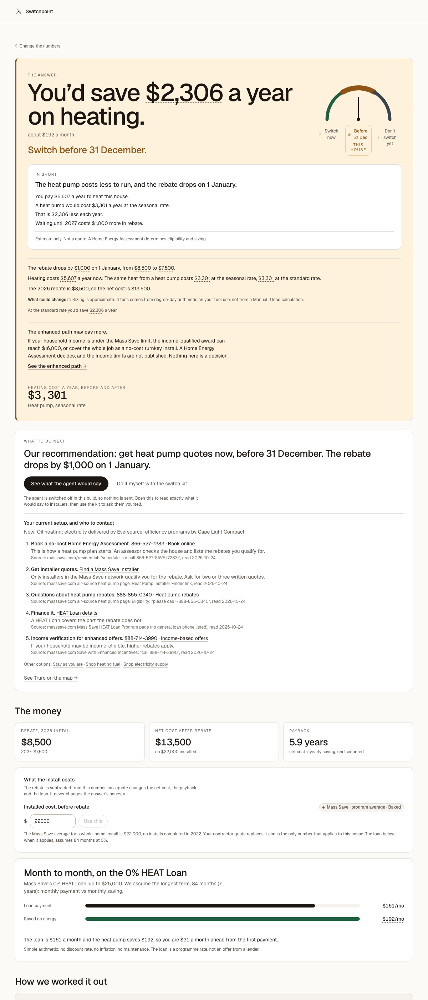

